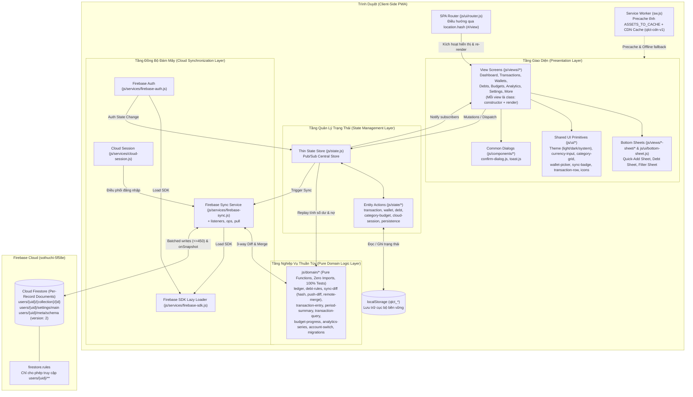

# System Architecture: Sổ Thu Chi (Pure Frontend + Firebase Cloud Sync)

## 1. Tổng Quan Kiến Trúc

Ứng dụng là một **Single Page Application (SPA)** thuần Client-Side, phát triển bằng **HTML5, Modern CSS3 và Vanilla JavaScript (ES Modules)**, không phụ thuộc vào framework bên ngoài hay công đoạn build (no npm, no package.json). Toàn bộ mã nguồn JavaScript được chia nhỏ theo trách nhiệm đơn lẻ, bảo đảm 100% file đều < 200 dòng code.

Ứng dụng hoạt động theo mô hình **Local-First**:
- Mọi dữ liệu thao tác lập tức phản hồi 0ms trên giao diện và được lưu trữ bền vững tại trình duyệt vào `localStorage` (các khóa có tiền tố `qlct_*`). Ứng dụng không trực tiếp sử dụng IndexedDB (chỉ có Firebase SDK sử dụng IndexedDB nội bộ để quản lý auth token và offline persistence).
- Tự động đồng bộ hóa đám mây realtime theo cơ chế per-record document với **Firebase Firestore**.
- Tuyệt đối không sử dụng biến toàn cục gắn trên `window.*` cho logic app.

---

## 2. Các Tầng Thành Phần (Architecture Layers)

### 2.1. Presentation Layer (Giao Diện Người Dùng & Điều Hướng)
- **Hệ thống Design Tokens & CSS**:
  - `css/variables.css`: Bảng màu, typography, khoảng cách spacing, radius, biến màu semantic cho 2 chế độ Sáng / Tối (`[data-theme="dark"]`).
  - `css/base.css`: CSS Reset chuẩn, kiểu dáng chữ và phần tử form cơ bản.
  - `css/layouts.css`: Khung ứng dụng (App Shell), responsive breakpoints:
    - **Desktop (≥1024px)**: Cột bên trái cố định (Sidebar `var(--sidebar-width, 260px)`), thanh tiêu đề trên cùng với nút ghi giao dịch nhanh.
    - **Mobile (<1024px)**: Thanh điều hướng đáy màn hình (Bottom Navigation Bar) đúng 5 mục: **Tổng quan · Giao dịch · [+] · Báo cáo · Thêm** với nút `+` (FAB) nổi bật ở giữa.
  - `css/ui.css`: Kiểu dáng cho các thành phần giao diện dùng chung (buttons, inputs, cards, badges, transaction rows, category grids).
  - `css/sheets.css`: Kiểu dáng cho cơ chế Bottom Sheet trượt mượt mà kèm backdrop làm mờ.
  - `css/views/*.css`: Kiểu dáng riêng biệt cho từng màn hình (`dashboard.css`, `transactions.css`, `wallets.css`, `debts.css`, `budgets.css`, `analytics.css`, `settings.css`).
- **Thành phần UI Dùng Chung** ([js/ui/](../js/ui/)):
  - [theme.js](../js/ui/theme.js): Quản lý 3 chế độ theme: Sáng (Light), Tối (Dark) và Theo hệ thống (System).
  - [bottom-sheet.js](../js/ui/bottom-sheet.js): Khối dựng modal trượt đáy (bottom sheet) với animation, kéo đóng và quản lý focus accessibility.
  - [currency-input.js](../js/ui/currency-input.js): Định dạng tiền tệ thời gian thực khi người dùng nhập số tiền (dạng hero input số lớn).
  - [category-grid.js](../js/ui/category-grid.js): Hiển thị lưới danh mục icon màu sắc trực quan, cho phép chọn nhanh trong 1 chạm.
  - [wallet-picker.js](../js/ui/wallet-picker.js): Thành phần chọn ví nguồn và ví đích linh hoạt.
  - [router.js](../js/ui/router.js): SPA Hash Router quản lý chuyển đổi view qua `location.hash` (`#/dashboard`, `#/transactions`, `#/wallets`, `#/debts`, `#/budgets`, `#/analytics`, `#/settings`, `#/more`), hỗ trợ nút Back trình duyệt và đồng bộ trạng thái active trên navigation.
  - [sync-badge.js](../js/ui/sync-badge.js): Huy hiệu hiển thị trạng thái kết nối Cloud trên header.
  - [transaction-row.js](../js/ui/transaction-row.js): Dòng giao dịch chuẩn hóa với biểu tượng danh mục, số tiền, ngày tháng và sự kiện click mở sửa giao dịch.
  - [icons.js](../js/ui/icons.js): Tiện ích kích hoạt render Lucide icons.
- **Màn Hình Giao Diện (Screens)** ([js/views/](../js/views/)):
  Mỗi màn hình được đóng gói trong một thư mục chuyên biệt, triển khai dưới dạng một class có `constructor(containerId)` và phương thức `render()`, được `router.js` tự động re-render mỗi khi màn hình được chuyển đến:
  - `dashboard/`: Thẻ tài sản lớn (hero card), tổng thu/chi tháng, cảnh báo nợ & ngân sách, danh sách giao dịch gần đây.
  - `transactions/`: Tìm kiếm không phân biệt dấu tiếng Việt, thanh lọc khoảng thời gian, mở filter sheet chi tiết, gom nhóm danh sách giao dịch theo từng ngày kèm tổng tiền ngày.
  - `transaction-sheet/`: Bottom sheet ghi chép giao dịch nhanh trong ~3 chạm: nhập số tiền lớn → chạm chọn hạng mục trên lưới icon → Lưu; tự động ghi nhớ loại giao dịch và ví lựa chọn gần nhất qua `last-entry.js`.
  - `debt-sheet/`: Bottom sheet chuyên biệt ghi chép các khoản Cho vay, Đi vay, Thu nợ và Trả nợ.
  - `wallets/`: Quản lý danh sách ví, số dư và modal thêm/sửa ví.
  - `debts/`: Danh sách khoản vay nợ, phân loại Cho vay / Đi vay, theo dõi tiến độ hoàn trả.
  - `budgets/`: Quản lý hạn mức ngân sách tháng và thanh tiến độ cảnh báo 3 mức màu.
  - `analytics/`: Phân tích tỷ trọng chi tiêu (Doughnut Chart) và xu hướng Thu/Chi 6 tháng (Bar Chart) qua `Chart.js`.
  - `settings/`: Cài đặt tài khoản Firebase, cấu hình Cloud, chuyển đổi theme, xuất/nhập sao lưu JSON & CSV.
  - `more/`: Màn hình điều hướng phụ trên mobile dẫn tới Ví, Vay/Nợ, Ngân sách và Cài đặt.
- **Hộp Thoại Dùng Chung** ([js/components/](../js/components/)):
  - [confirm-dialog.js](../js/components/confirm-dialog.js): Hộp thoại xác nhận thao tác nguy hiểm (xoá dữ liệu, ghi đè cloud...).
  - [toast.js](../js/components/toast.js): Thông báo trạng thái nổi (toast).

### 2.2. State Management Layer (Quản Lý Trạng Thái Tập Trung)
- [js/state.js](../js/state.js) đóng vai trò là một **Thin Store** (mẫu thiết kế Pub/Sub singleton `stateStore` < 200 dòng) làm nguồn dữ liệu chân thực duy nhất (Single Source of Truth).
- Toàn bộ logic thao tác (actions) được phân tách thành các module chuyên biệt trong thư mục [js/state/](../js/state/):
  - [transaction-actions.js](../js/state/transaction-actions.js): Thêm, sửa, xoá giao dịch; tự động tính lại số dư ví và lưu trữ.
  - [wallet-actions.js](../js/state/wallet-actions.js): Thêm, sửa, xoá ví và tính toán số dư ví bằng domain ledger.
  - [debt-actions.js](../js/state/debt-actions.js): Thêm khoản nợ, ghi nhận trả nợ, sửa, xoá khoản nợ.
  - [category-budget-actions.js](../js/state/category-budget-actions.js): Quản lý hạng mục, màu sắc duy nhất, thiết lập và xoá ngân sách tháng.
  - [cloud-session-actions.js](../js/state/cloud-session-actions.js): Khởi tạo Firebase, thay thế dữ liệu local khi đổi tài khoản, áp dụng thay đổi remote, nhập dữ liệu.
  - [persistence.js](../js/state/persistence.js): Nạp trạng thái ban đầu từ `localStorage`, lưu trữ trạng thái xuống `localStorage` qua `STORAGE_KEYS` tiền tố `qlct_*`, dọn dẹp khóa cũ.

### 2.3. Pure Domain Logic Layer (Logic Nghiệp Vụ Thuần Túy)
Thư mục [js/domain/](../js/domain/) gồm các module nghiệp vụ thuần túy (Pure Functions, **zero imports**, không phụ thuộc DOM, `localStorage` hay `Firebase`), được kiểm thử kỹ lưỡng qua unit test:
- [ledger.js](../js/domain/ledger.js): Tính toán số dư ví bằng hàm `computeWalletBalances()`. Số dư ví không bị cập nhật tùy tiện mà luôn được tính toán lại từ đầu bằng cách replay toàn bộ giao dịch (Chi, Thu, Chuyển tiền) và các khoản vay/trả nợ.
- [debt-rules.js](../js/domain/debt-rules.js): Xử lý quy tắc trả nợ (thanh toán từng phần, thanh toán toàn bộ) và xác thực tính hợp lệ của khoản hoàn trả.
- [sync-diff.js](../js/domain/sync-diff.js): Module trung tâm re-export các chức năng đồng bộ đám mây thuần túy từ:
  - [record-hash.js](../js/domain/record-hash.js): Logic băm bản ghi (`hashRecord`), chuẩn hóa dữ liệu cloud per-record.
  - [push-diff.js](../js/domain/push-diff.js): Trích xuất sai khác để đẩy lên cloud (`diffForPush`) và cập nhật baseline hash.
  - [remote-merge.js](../js/domain/remote-merge.js): Hợp nhất 3 chiều (`mergeRemoteChanges`) và bảo toàn thứ tự ban đầu của danh mục/ví.
- [transaction-entry.js](../js/domain/transaction-entry.js): Xác thực tính hợp lệ của giao dịch khi nhập (`validateEntry`) và giải quyết các giá trị mặc định (`resolveEntryDefaults`) dựa trên lựa chọn gần nhất.
- [period-summary.js](../js/domain/period-summary.js): Tổng hợp số liệu thu, chi, tiết kiệm theo tháng (`monthSummary`), phát hiện cảnh báo ngân sách (`budgetAlerts`) và gom nhóm giao dịch theo từng ngày (`groupByDay`).
- [transaction-query.js](../js/domain/transaction-query.js): Tìm kiếm chuỗi không phân biệt dấu tiếng Việt (`normalizeVietnamese`), tính khoảng thời gian (`getDateRange`), lọc giao dịch đa tiêu chí (`filterTransactions`) và tính tổng thu chi chuyển khoản.
- [budget-progress.js](../js/domain/budget-progress.js): Tính toán phần trăm tiến độ sử dụng ngân sách, xác định mức cảnh báo màu sắc (xanh/vàng/đỏ) và số tiền còn lại.
- [analytics-series.js](../js/domain/analytics-series.js): Xử lý dữ liệu biểu đồ phân bổ hạng mục chi tiêu và chuỗi xu hướng Thu/Chi 6 tháng gần nhất.
- [legacy-migration.js](../js/domain/legacy-migration.js): Phân tích và chuyển đổi cấu trúc dữ liệu cũ (mảng trong document `users/{uid}/data/{table}`) sang định dạng per-record document, khử trùng lặp theo ID và timestamp.
- [account-switch.js](../js/domain/account-switch.js): Ra quyết định an toàn khi chuyển đổi tài khoản hoặc đăng nhập lần đầu khi cả hai phía đều có dữ liệu.
- [settings-migration.js](../js/domain/settings-migration.js): Chuẩn hóa và làm sạch cấu hình settings cũ.
- [export-sanitize.js](../js/domain/export-sanitize.js): Làm sạch dữ liệu xuất file JSON và chống formula injection trong file CSV.

### 2.4. Cloud Synchronization Layer (Đồng Bộ Đám Mây Firebase)
Đồng bộ đám mây sử dụng nền tảng Firebase Firestore làm dịch vụ duy nhất:
- **Tải lười SDK** ([js/services/firebase-sdk.js](../js/services/firebase-sdk.js)): Tải Firebase Modular SDK v10.13.0 theo nhu cầu qua `import()` động từ `gstatic.com`, không làm chậm quá trình khởi động ban đầu.
- **Xác thực** ([js/services/firebase-auth.js](../js/services/firebase-auth.js)): Hỗ trợ Đăng nhập Google qua popup và Đăng nhập Ẩn danh (Guest).
- **Cấu trúc dữ liệu Firestore**:
  - Cấu trúc per-record: Mỗi bản ghi là một document độc lập tại `users/{uid}/{transactions|wallets|categories|budgets|debts}/{id}` và cài đặt tại `users/{uid}/settings/main`.
  - Phiên bản schema: Đánh dấu tại `users/{uid}/meta/schema` với `{ version: 2 }`.
- **Cơ chế nâng cấp dữ liệu cũ (Legacy Migration)** ([js/services/firebase-migration.js](../js/services/firebase-migration.js)):
  - Nếu phát hiện cấu trúc cũ (`users/{uid}/data/{table}` chứa mảng `items`), hệ thống hiển thị hộp thoại xác nhận nâng cấp.
  - Tự động tải xuống file sao lưu JSON dữ liệu trên máy trước khi nâng cấp.
  - Các document cũ trên Cloud được giữ nguyên, không bao giờ bị xóa.
- **Động cơ đồng bộ realtime** ([js/services/firebase-sync.js](../js/services/firebase-sync.js)):
  Module điều phối chính gọn gàng (< 200 dòng), phân chia nhiệm vụ cho các sub-modules:
  - [firebase-sync-listeners.js](../js/services/firebase-sync-listeners.js): Thiết lập và hủy lắng nghe `onSnapshot` cho từng collection.
  - [firebase-sync-ops.js](../js/services/firebase-sync-ops.js): Thực hiện đợt đẩy dữ liệu (`flushSync`) và đẩy toàn bộ dữ liệu (`pushAllData`) theo lô ≤ 450 thao tác/lần.
  - [firebase-sync-pull.js](../js/services/firebase-sync-pull.js): Kéo toàn bộ dữ liệu từ Cloud (`pullAllData`) và kiểm tra dữ liệu hiện có của tài khoản.
  - Lưu trữ baseline hash của từng bản ghi vào `localStorage` theo khóa `qlct_sync_baseline_{uid}` để phát hiện chính xác thay đổi 3 chiều (local changes vs remote changes).
  - Trì hoãn việc đẩy dữ liệu lên Cloud cho đến khi nhận đủ snapshot ban đầu từ tất cả collections để tránh ghi đè dữ liệu trên Cloud bằng dữ liệu mặc định local.
  - Hỗ trợ thao tác thủ công "Đẩy toàn bộ lên Cloud" và "Kéo toàn bộ về máy" từ giao diện Cài đặt.
  - *Hạn chế đã biết*: Khi đang đăng nhập Cloud, nếu người dùng nhập (import) một file sao lưu JSON thì dữ liệu Cloud sẽ được đồng bộ khớp với file đó (những bản ghi trên Cloud không có trong file JSON sẽ bị xóa khỏi Cloud).
- **Quy tắc bảo mật** ([firestore.rules](../firestore.rules)):
  - Mỗi tài khoản đã đăng nhập chỉ có quyền đọc/ghi dữ liệu trong cây tài liệu của chính mình (`match /users/{uid}/{document=**}`).

### 2.5. PWA & Caching Layer
- Service Worker ([sw.js](../sw.js)) thiết lập chiến lược lưu bộ nhớ đệm:
  - Danh sách tĩnh `ASSETS_TO_CACHE`: Precache toàn bộ file HTML, CSS, JS và Icons (chiến lược Cache-First kèm cập nhật ngầm).
  - Test tự động ([tests/sw-assets.test.mjs](../tests/sw-assets.test.mjs)) bảo đảm mọi file mới tạo trong `js/`, `css/`, `assets/icons/` đều bắt buộc phải có mặt trong danh sách này.
  - Bộ nhớ đệm runtime `qlct-cdn-v1`: Lưu cache các thư viện CDN bên ngoài (Lucide Icons 1.72.0, Chart.js 4.6.1).
  - *Giới hạn trình duyệt*: Chế độ offline chỉ hoạt động sau khi người dùng đã truy cập trực tuyến ít nhất một lần.

---

## 3. Luồng Xử Lý Khi Đăng Nhập (Sign-in Flow)

Khi người dùng thực hiện đăng nhập qua Google hoặc Ẩn danh:
1. `firebaseAuthService` ghi nhận user và kích hoạt sự kiện `auth:changed`.
2. `cloudSession` kiểm tra phiên bản dữ liệu trên Cloud qua `getCloudSchemaState(uid)`.
   - Nếu dữ liệu đang ở định dạng cũ (`state === 'legacy'`), hiển thị thông báo yêu cầu nâng cấp, tự động backup JSON và chuyển đổi dữ liệu.
3. So sánh UID vừa đăng nhập với UID của lần đăng nhập trước (`qlct_last_auth_uid`):
   - **Tài khoản khác nhau**: Xóa dữ liệu local hiện tại và thay thế bằng dữ liệu mới tinh (hoặc dữ liệu từ Cloud) để tránh lẫn lộn dữ liệu giữa 2 tài khoản.
   - **Cùng tài khoản nhưng cả hai phía đều có dữ liệu mới**: Hệ thống đưa ra lựa chọn:
     - *"Dùng dữ liệu Cloud"*: Tải backup máy về rồi thay thế dữ liệu trên máy bằng dữ liệu Cloud.
     - *"Ghi đè Cloud"*: Ghi đè toàn bộ dữ liệu trên máy lên Cloud.
     - *"Gộp cả hai"* (Mặc định): Giữ nguyên dữ liệu cả hai bên và tiến hành merge 3-way.
4. Bắt đầu lắng nghe realtime sync và lưu `qlct_last_auth_uid`.
