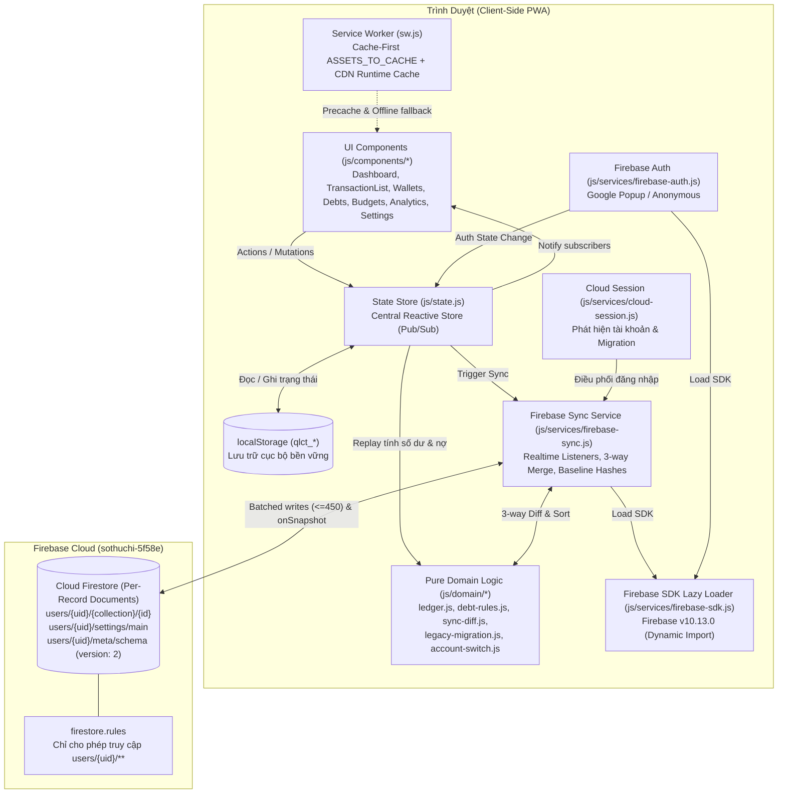

# System Architecture: Sổ Thu Chi (Pure Frontend + Firebase Cloud Sync)

## 1. Tổng Quan Kiến Trúc

Ứng dụng là một **Single Page Application (SPA)** thuần Client-Side, phát triển bằng **HTML5, Modern CSS3 và Vanilla JavaScript (ES Modules)**, không phụ thuộc vào framework bên ngoài hay công đoạn build (no npm, no package.json). 

Ứng dụng hoạt động theo mô hình **Local-First**:
- Mọi dữ liệu thao tác lập tức phản hồi 0ms trên giao diện và được lưu trữ bền vững tại trình duyệt vào `localStorage` (các khóa có tiền tố `qlct_*`). Ứng dụng không trực tiếp sử dụng IndexedDB (chỉ có Firebase SDK sử dụng IndexedDB nội bộ để quản lý auth token và offline persistence).
- Tự động đồng bộ hóa đám mây realtime theo cơ chế per-record document với **Firebase Firestore**.

---

## 2. Các Tầng Thành Phần (Architecture Layers)

### 2.1. Presentation Layer (Giao Diện Người Dùng)
- **Cấu trúc**: Semantic HTML5, CSS Grid & Flexbox, CSS Custom Properties (`css/variables.css`) hỗ trợ chuyển đổi giao diện Sáng/Tối (`Light/Dark Mode`).
- **Thành phần UI** ([js/components/](../js/components/)):
  - [dashboard.js](../js/components/dashboard.js): Thẻ chỉ số tài chính, biểu đồ nhanh và giao dịch gần đây.
  - [transaction-list.js](../js/components/transaction-list.js): Danh sách giao dịch gom nhóm theo ngày kèm bộ lọc đa năng.
  - [transaction-modal.js](../js/components/transaction-modal.js): Modal nhập liệu nhanh Thu / Chi / Chuyển khoản với phím tắt tiền tệ.
  - [wallets.js](../js/components/wallets.js): Quản lý sổ ví và tài khoản.
  - [debts.js](../js/components/debts.js): Quản lý sổ nợ (Cho vay / Đi vay) và tiến độ trả nợ.
  - [budgets.js](../js/components/budgets.js): Thiết lập hạn mức ngân sách tháng và thanh tiến độ cảnh báo.
  - [analytics.js](../js/components/analytics.js): Báo cáo phân tích thu chi qua biểu đồ `Chart.js` (Doughnut & Bar).
  - [settings.js](../js/components/settings.js): Đăng nhập Firebase, cấu hình Cloud, xuất/nhập JSON & CSV, đổi theme.
  - [confirm-dialog.js](../js/components/confirm-dialog.js) & [toast.js](../js/components/toast.js): Hộp thoại xác nhận hành động nguy hiểm và thông báo trạng thái.

### 2.2. State Management Layer (Quản Lý Trạng Thái Tập Trung)
- [js/state.js](../js/state.js) chứa lớp `StateStore` (mẫu thiết kế Pub/Sub) là nguồn dữ liệu chân thực duy nhất (Single Source of Truth) của ứng dụng.
- Quản lý các tập dữ liệu: `transactions`, `wallets`, `categories`, `budgets`, `debts`, `settings`.
- Mọi thao tác thay đổi trạng thái gọi `saveToStorage()` và thông báo tới các listeners để UI tự động cập nhật:
  - **Lưu trữ cục bộ**: Lưu trực tiếp vào `localStorage` qua [js/services/storage.js](../js/services/storage.js) sử dụng các khóa `STORAGE_KEYS` định nghĩa trong [js/config.js](../js/config.js) (`qlct_transactions`, `qlct_wallets`, `qlct_categories`, `qlct_budgets`, `qlct_debts`, `qlct_settings`).
  - **Lưu ý về IndexedDB**: Bản thân ứng dụng không dùng IndexedDB; chỉ có Firebase SDK sử dụng IndexedDB nội bộ để lưu auth token và cache dữ liệu ngoại tuyến của Firestore.

### 2.3. Pure Domain Logic Layer (Logic Nghiệp Vụ Thuần Túy)
Thư mục [js/domain/](../js/domain/) gồm các module thuần túy (Pure Functions, **zero imports**, không phụ thuộc DOM, `localStorage` hay `Firebase`), được kiểm thử kỹ lưỡng qua unit test:
- [ledger.js](../js/domain/ledger.js): Tính toán số dư ví bằng hàm `computeWalletBalances()`. Số dư ví không bị cập nhật tùy tiện mà luôn được tính toán lại từ đầu bằng cách replay toàn bộ giao dịch (Chi, Thu, Chuyển tiền) và các khoản vay/trả nợ.
- [debt-rules.js](../js/domain/debt-rules.js): Xử lý quy tắc trả nợ (thanh toán từng phần, thanh toán toàn bộ) và xác thực tính hợp lệ của khoản hoàn trả.
- [sync-diff.js](../js/domain/sync-diff.js): Logic băm bản ghi (`hashRecord`), trích xuất sai khác để đẩy lên cloud (`diffForPush`), hợp nhất 3 chiều (`mergeRemoteChanges`) và sắp xếp bản ghi đảm bảo thứ tự ban đầu của danh mục/ví.
- [legacy-migration.js](../js/domain/legacy-migration.js): Phân tích và chuyển đổi cấu trúc dữ liệu cũ (mảng trong document `users/{uid}/data/{table}`) sang định dạng per-record document, khử trùng lặp theo ID và timestamp.
- [account-switch.js](../js/domain/account-switch.js): Ra quyết định an toàn khi chuyển đổi tài khoản hoặc đăng nhập lần đầu khi cả hai phía đều có dữ liệu.
- [settings-migration.js](../js/domain/settings-migration.js): Chuẩn hóa và làm sạch cấu hình settings cũ.

### 2.4. Cloud Synchronization Layer (Đồng Bộ Đám Mây Firebase)
Đồng bộ đám mây sử dụng nền tảng Firebase Firestore làm dịch vụ duy nhất:
- **Tải lười SDK** ([js/services/firebase-sdk.js](../js/services/firebase-sdk.js)): Tải Firebase Modular SDK v10.13.0 theo nhu cầu qua `import()` động từ `gstatic.com`, không làm chậm quá trình khởi động ban đầu.
- **Xác thực** ([js/services/firebase-auth.js](../js/services/firebase-auth.js)): Hỗ trợ Đăng nhập Google qua popup và Đăng nhập Ẩn danh (Guest).
- **Cấu trúc dữ liệu Firestore**:
  - Cấu trúc per-record: Mỗi bản ghi là một document độc lập tại `users/{uid}/{transactions|wallets|categories|budgets|debts}/{id}` và cài đặt tại `users/{uid}/settings/main`.
  - Phiên bản schema: Đánh dấu tại `users/{uid}/meta/schema` với `{ version: 2 }`.
- **Cơ chế nâng cấp dữ liệu cũ (Legacy Migration)** ([js/services/firebase-migration.js](../js/services/firebase-migration.js)):
  - Nếu phát hiện cấu trúc cũ (`users/{uid}/data/{table}` chứa mảng `items`), hệ thống hiển thị hộp thoại xác nhận nâng cấp.
  - Tự động tải xuống file sao lưu JSON dữ liệu trên máy trước khi nâng cấp.
  - Các document cũ trên Cloud được giữ nguyên, không bao giờ bị xóa.
- **Động cơ đồng bộ realtime** ([js/services/firebase-sync.js](../js/services/firebase-sync.js)):
  - Lắng nghe realtime qua `onSnapshot` cho từng collection.
  - Lưu trữ baseline hash của từng bản ghi vào `localStorage` theo khóa `qlct_sync_baseline_{uid}` để phát hiện chính xác thay đổi 3 chiều (local changes vs remote changes).
  - Trì hoãn việc đẩy dữ liệu lên Cloud cho đến khi nhận đủ snapshot ban đầu từ tất cả collections để tránh ghi đè dữ liệu trên Cloud bằng dữ liệu mặc định local.
  - Ghi theo lô (batch writes) khống chế tối đa ≤ 450 thao tác/lần (tuân thủ giới hạn 500 của Firestore).
  - Hỗ trợ thao tác thủ công "Đẩy toàn bộ lên Cloud" và "Kéo toàn bộ về máy" từ giao diện Cài đặt.
  - *Hạn chế đã biết*: Khi đang đăng nhập Cloud, nếu người dùng nhập (import) một file sao lưu JSON thì dữ liệu Cloud sẽ được đồng bộ khớp với file đó (những bản ghi trên Cloud không có trong file JSON sẽ bị xóa khỏi Cloud).
- **Quy tắc bảo mật** ([firestore.rules](../firestore.rules)):
  - Mỗi tài khoản đã đăng nhập chỉ có quyền đọc/ghi dữ liệu trong cây tài liệu của chính mình (`match /users/{uid}/{document=**}`).

### 2.5. PWA & Caching Layer
- Service Worker ([sw.js](../sw.js)) thiết lập chiến lược lưu bộ nhớ đệm:
  - Danh sách tĩnh `ASSETS_TO_CACHE`: Precache toàn bộ file HTML, CSS, JS và Icons (chiến lược Cache-First kèm cập nhật ngầm).
  - Test tự động ([tests/sw-assets.test.mjs](../tests/sw-assets.test.mjs)) bảo đảm mọi file mới tạo trong `js/`, `css/`, `assets/icons/` đều bắt buộc phải có mặt trong danh sách này.
  - Bộ nhớ đệm runtime `qlct-cdn-v1`: Lưu cache các thư viện CDN bên ngoài (Lucide Icons 1.72.0, Chart.js 4.6.1).
  - *Giới hạn trình duyệt*: Chế độ offline chỉ hoạt động sau khi người dùng đã truy cập trực tuyến ít nhất một lần.

---

## 3. Luồng Xử Lý Khi Đăng Nhập (Sign-in Flow)

Khi người dùng thực hiện đăng nhập qua Google hoặc Ẩn danh:
1. `firebaseAuthService` ghi nhận user và kích hoạt sự kiện `auth:changed`.
2. `cloudSession` kiểm tra phiên bản dữ liệu trên Cloud qua `getCloudSchemaState(uid)`.
   - Nếu dữ liệu đang ở định dạng cũ (`state === 'legacy'`), hiển thị thông báo yêu cầu nâng cấp, tự động backup JSON và chuyển đổi dữ liệu.
3. So sánh UID vừa đăng nhập với UID của lần đăng nhập trước (`qlct_last_auth_uid`):
   - **Tài khoản khác nhau**: Xóa dữ liệu local hiện tại và thay thế bằng dữ liệu mới tinh (hoặc dữ liệu từ Cloud) để tránh lẫn lộn dữ liệu giữa 2 tài khoản.
   - **Cùng tài khoản nhưng cả hai phía đều có dữ liệu mới**: Hệ thống đưa ra lựa chọn:
     - *"Dùng dữ liệu Cloud"*: Tải backup máy về rồi thay thế dữ liệu trên máy bằng dữ liệu Cloud.
     - *"Ghi đè Cloud"*: Ghi đè toàn bộ dữ liệu trên máy lên Cloud.
     - *"Gộp cả hai"* (Mặc định): Giữ nguyên dữ liệu cả hai bên và tiến hành merge 3-way.
4. Bắt đầu lắng nghe realtime sync và lưu `qlct_last_auth_uid`.
