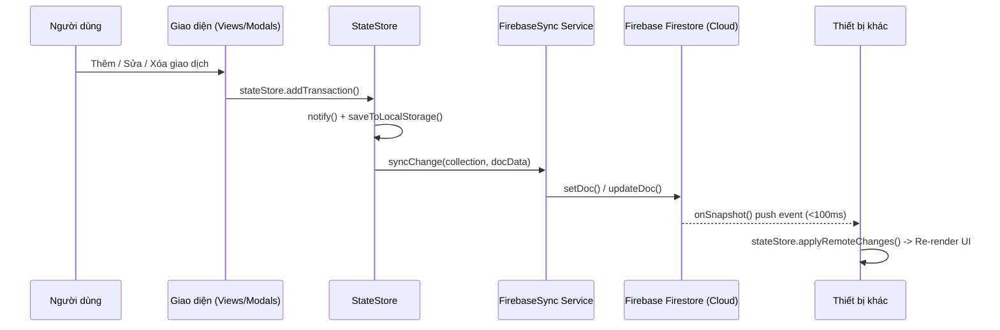

# Firebase Realtime Sync Implementation Plan

## Overview
Nâng cấp hệ thống đồng bộ của ứng dụng **Sổ Thu Chi** từ phương thức thủ công (Manual Google Sheets Push/Pull) lên **Realtime Sync hai chiều tức thì (<100ms)** sử dụng **Firebase Cloud Firestore + Firebase Authentication**, đồng thời giữ nguyên khả năng hoạt động offline (Local-First Persistence) và tương thích hoàn toàn với nền tảng Vanilla JS hiện tại.

## User Review Required
> [!IMPORTANT]
> - Firebase SDK sẽ được nạp qua CDN ES Modules (`https://www.gstatic.com/firebasejs/10.x/...`), không cần Node build step / bundler.
> - Người dùng có thể Đăng nhập Google hoặc dùng Ẩn danh (Anonymous) để bắt đầu đồng bộ Realtime ngay lập tức.
> - Tính năng xuất/nhập Google Sheets cũ vẫn được giữ lại làm tùy chọn sao lưu phụ (Secondary Backup).

## Proposed Phases

| Phase | Title | Description | Status |
| :--- | :--- | :--- | :--- |
| **01** | Firebase Infrastructure & Auth Service | Tích hợp Firebase SDK qua ESM CDN, module `firebase-auth.js`, cấu hình config linh hoạt | Completed |
| **02** | Firestore Realtime Sync Engine | Xây dựng `firebase-sync.js` với granular collections, `onSnapshot` listener, chống echo-loop | Completed |
| **03** | UI Settings & Realtime Status Indicator | Cập nhật giao diện Cài đặt, thêm Live Status Badge (🟢/🟡/🔴) trên Sidebar/Header | Completed |
| **04** | Offline Cache, Conflict Handling & Testing | Kiểm thử offline IndexedDB persistence, conflict resolution, migration từ LocalStorage | Completed |

## Architecture & Data Flow

## Related Files
- `js/services/firebase-auth.js` [NEW]
- `js/services/firebase-sync.js` [NEW]
- `js/config.js` [MODIFY]
- `js/state.js` [MODIFY]
- `js/components/settings.js` [MODIFY]
- `index.html` [MODIFY]
- `css/components.css` [MODIFY]
- `sw.js` [MODIFY]
